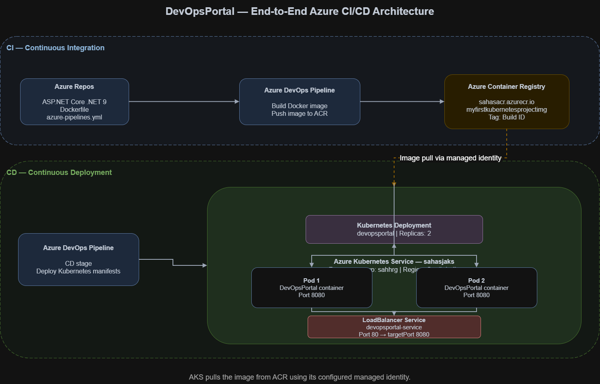

# DevOpsPortal – End-to-End Azure DevOps Project

An end-to-end DevOps implementation demonstrating Docker containerization, Azure DevOps CI/CD, Azure Container Registry (ACR), and Azure Kubernetes Service (AKS).

## Project Overview

This project demonstrates how to build, containerize, and deploy an ASP.NET Core application to Azure Kubernetes Service using automated CI/CD pipelines.

## Technology Stack

- **Application:** ASP.NET Core .NET 9
- **Containerization:** Docker
- **Container Registry:** Azure Container Registry (ACR)
- **Container Orchestration:** Azure Kubernetes Service (AKS)
- **CI/CD:** Azure DevOps Pipelines
- **Source Control:** Git and Azure Repos
- **Cloud Platform:** Microsoft Azure
- **Deployment:** Kubernetes

## Architecture

Azure Repos → Azure DevOps Pipeline → Docker Build → ACR → AKS → Kubernetes Pods → LoadBalancer

## Architecture - Diagram

  

## Implementation

### 1. Application Development
Developed a DevOps learning portal using ASP.NET Core .NET 9.

### 2. Docker Containerization
- Created a multi-stage Dockerfile.
- Built and tested the Docker image locally.
- Ran the application inside a Docker container.

### 3. Azure Container Registry
- Created an Azure Container Registry.
- Configured Azure DevOps to build and push Docker images to ACR.
- Integrated AKS with ACR using managed identity.

### 4. CI/CD Pipeline
- Configured a CI pipeline to build and push Docker images.
- Configured a CD pipeline to deploy Kubernetes manifests to AKS.
- Automated application deployment using Azure DevOps.

### 5. Kubernetes Deployment
- Created Kubernetes Deployment and Service manifests.
- Configured two application replicas.
- Exposed the application using a LoadBalancer Service.

## Project Outcomes

- Automated Docker image creation and publishing.
- Implemented CI/CD using Azure DevOps.
- Deployed a containerized application to AKS.
- Integrated ACR and AKS using managed identity.
